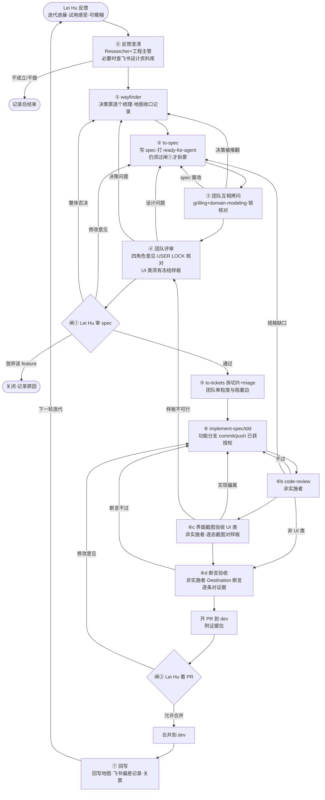

# natural-enforcement-prj 开发 loop 设计（讨论稿 v0.2.1）
日期：2026-10-16 23:00（UTC+8）起草；2026-10-17 改定 spec 打 `ready-for-agent`，并从 box 迁入仓库 `docs/process/loop-design.md`（以本文件为准）。文中 `tmp/…`、`/tmp/…` 路径为 box 上的历史草稿位置，已废弃，仅作出处记录。
依据：技能原文 `S=/home/box/agent-data/plugins/cache/mattpocock/mattpocock-skills/*/skills/engineering/*/SKILL.md`；仓库 dev 分支上的 `docs/agents/issue-tracker.md`、`docs/agents/triage-labels.md`；#62 正文；仓库现有标签；`tmp/loop-review/` 下三位成员的意见。

## v0.2.1 变更摘要
- 断言验收前移：原来在合并后的 ⑦「断言对证据」，改为开 PR 前的 ⑥d「断言验收」。由非实施者执行，结果作为 PR 证据包的一部分，不通过退回 ⑥。合并后的 ⑦ 只保留「回写地图和飞书偏差记录」，避免验收没过的代码进入 dev。

## v0.2 变更摘要（按 Lei Hu 10-16 意见）
1. **Lei Hu 只在三处介入**：反馈输入、闸①（拆票前审 spec）、闸②（合并前审 PR）。v0.1 中由他参与的其余环节全部取消，包括 G0、G1、G2、拷问由他回答、逐个授权 commit、确认回写飞书，改由团队内部讨论和互审解决。
2. **新增「⓪ 反馈澄清」入口**：Researcher 和工程主管把模糊反馈整理成清楚的问题和方案，必要时查飞书设计资料库，然后进入 wayfinder。不把问题推回给 Lei Hu。
3. **grill-with-docs 改为团队成员互相拷问**，回答方不再是 Lei Hu。
4. **授权口径**：spec 通过闸①后，在功能分支上 commit、push、开 PR 即已获授权；合并必须等闸②他同意；不得直接推 dev 或 main；提交格式不变。
5. **依据口径已裁定**：以 GitHub Issues 和代码库里的实际代码为准；飞书只作参考，不照抄，使用前团队讨论确认合理性，可以在其基础上优化；USER LOCK 是硬约束，迁入仓库锁清单，每条对应测试断言。飞书 WF「以飞书为准」与此冲突，按此裁定处理。
6. **UI 样板（④的准入）和 ⑥c 截图验收保留**，改为团队内部把关。
7. **待拍板清单从 12 条压到 3 条**，其余各条改为「团队自定」并写明理由；业务和法条类事项随闸①审。
8. **新增「对 Lei Hu 方案的异议与风险」一节**，共 5 条。

## 结论
1. 流程为 ⓪ 反馈澄清 → ① wayfinder → ② to-spec → ③ 团队互相拷问 → ④ 团队评审 → **闸①** → ⑤ 拆票与 triage → ⑥ 实施、互审、截图验收、断言验收 → 开 PR → **闸②** → 合并 → ⑦ 回写地图与飞书偏差记录。
2. 技能默认行为有三处要在项目层覆盖：
   - to-spec 给 spec 打 `ready-for-agent`：照 to-spec 约定打（Lei Hu 2026-10-17 定）；打了标签仍须等闸① Lei Hu 审过 spec 才拆票、开工；
   - to-tickets 默认给票打 `ready-for-agent`：只在闸①通过后拆票，拆完由团队 triage；
   - implement-spec 默认开 draft PR、由 agent 合入：只在功能分支上工作，合并到 dev 必须等闸②。
3. 把关靠职责分离：实施者不审自己的代码，验收只认证据。USER LOCK 由仓库锁清单和测试断言兜底。
4. 当前状态：#62 的子票 12/12 已关，但地图还开着。M0a 还没过，A1–A10 只覆盖 M0b 的一部分。团队要先在 ① 内补齐收口记录和断言归属，再写 spec 报闸①。

## 1. Loop 图

（注：图中 Lei Hu 只出现在三处：「Lei Hu 反馈」「闸①」「闸②」。⑥d 不通过退回 ⑥；如果是缺票或规格缺口，由团队自己补票（退回 ⑤），不改变 spec 的不再报闸①；改变 spec 的回到 ② 并重新报闸①。）

## 2. 每步一行
| 步 | 负责人 | 准入 | 准出 | 产物 | 退回到 |
|---|---|---|---|---|---|
| ⓪ 反馈澄清 | Researcher、工程主管 | 收到 Lei Hu 的反馈（可模糊） | 反馈改写成清楚的问题陈述和初步方案；判定为新 feature、已有 feature 修订或不做；所查飞书资料按 doc_token＋节＋version 记录 | 澄清记录（问题、方案、依据），新建或更新地图 | 不成立时记录原因后结束，不推回给 Lei Hu |
| ① wayfinder | 工程主管驱动；软件工程师、前端负责 grilling 和 prototype 票；Researcher 负责 research 票 | ⓪ 产出；有 `wayfinder:map`，Destination 写明里程碑断言 | 子票全关；雾区清空或移入 Out of scope；地图写收口记录（含断言与里程碑的映射） | 决策票答复、Decisions so far 索引、ADR/GLOSSARY | — |
| ② to-spec | 软件工程师（前端补交互部分） | ① 收口；USER LOCK 清单附上 | spec 按模板写齐；开头有「对反馈的理解」段（反馈原话、团队理解、反例、具体场景）；业务和法条分歧列为「待 Lei Hu 定」；每条决策注明来源票或 ADR；飞书引用写 doc_token＋节＋version；与飞书有偏离的地方逐条写理由；测试 seam 已列出；**打 `ready-for-agent`，但闸①通过前不拆票、不开工** | spec issue | ① |
| ③ 团队互相拷问 | 工程主管组织，各角色互相提问和回答 | spec 草稿 | 只拷问 spec 相对地图决议的增量；问题全部有答案；seam 由团队确认；锁核对通过（未改动或弱化任何 LOCK） | 拷问记录、ADR、GLOSSARY | ①（决策被推翻）／②（spec 需改） |
| ④ 团队评审 | 四角色各出一份意见；工程主管汇总 | ③ 完成；**UI 类 feature 另须有冻结的 HTML 样板**（写明字段短表版本和 LOCK 编号，覆盖全部状态，用户可见文本不含工程词） | 无未决阻断项；USER LOCK 逐条核对通过；与飞书的偏差已列清单；UI 类的界面部分一轮审完（前端出样板，工程主管先验门，团队同轮审），样板冻结为 vX.Y | 评审意见与汇总、冻结样板 | ②（设计）／①（决策） |
| **闸①** | Lei Hu 审，工程主管报送 | ④ 通过 | Lei Hu 通过 | 审阅记录 | 修改意见 → ②；整体否决 → ①，或放弃该 feature |
| ⑤ 拆票与 triage | 软件工程师拆票；工程主管审粒度并 triage | 闸① 通过 | 纵向切片；阻塞边正确；每票的验收条目对应断言编号和 LOCK 编号；UI 票带界面块；重复检查（`.out-of-scope/`、现有资产）已做；可开工票打 `ready-for-agent` | 切片票 | ⑤（重拆） |
| ⑥ 实施 | 软件工程师、前端（实施者） | 票是 `ready-for-agent`，前置阻塞票都已关 | 测试红→绿；每张票都有断言对照证据；在功能分支上按格式 commit 和 push | 代码、测试日志、证据包 | ⑤（补票）／②（规格缺） |
| ⑥b code-review | 非实施者（工程主管或另一角色） | ⑥ 准出；以功能分支相对 dev 的 diff 为比较对象 | Standards 和 Spec 两轴都无阻断项 | 评审报告 | ⑥／② |
| ⑥c 界面截图验收（仅 UI 类） | 非实施者（前端交互设计工程师或工程主管；前端是实施者时由工程主管负责） | ⑥b 通过；有冻结样板 vX.Y 和状态清单 | 按状态清单用 Playwright 逐态截图，截图须晚于本版 HTML 且与样板同名同版；有并排偏差表；工程词扫描通过；LOCK 路径有用例；**缺图不能开 PR、不能关票** | 截图、偏差表、扫描结果 | ⑥（实现偏离）／④（样板不可行） |
| ⑥d 断言验收 | 非实施者（工程主管；工程主管参与实施时由另一非实施角色负责） | ⑥b 通过（UI 类还须 ⑥c 通过） | Destination 和票中的断言逐条附证据（测试名、输出、截图）；锁清单断言全部通过；CI 全绿；**不通过退回 ⑥** | 断言验收表（并入 PR 证据包） | ⑥；缺票退回 ⑤；规格缺口退回 ② |
| 开 PR | 工程主管 | ⑥b 通过（UI 类还须 ⑥c 通过）；⑥d 通过 | PR 指向 dev；PR 模板强制附验收证据（含 ⑥d 断言验收表）、锁清单断言结果、spec 对照表（反馈→spec→实现→测试）和评审报告；CI 全绿；触及权限、留痕、定案门禁的，附强制检查清单 | PR | ⑥ |
| **闸②** | Lei Hu 看 PR | PR 已开 | Lei Hu 允许合并 | 审阅记录 | 修改意见 → ⑥ |
| 合并 | 见待拍板第 1 条 | 闸② 允许 | 合并进 dev | 合并记录 | — |
| ⑦ 回写地图与飞书偏差记录 | 工程主管回写地图；Researcher 整理飞书偏差 | 已合并 | 关票；回写子 Map 和根 Map #9（Decisions/验收状态，链接 ⑥d 验收表）；飞书偏差记入仓库清单 | 地图回写、偏差清单 | — （新问题作为下一轮反馈进入 ⓪） |

## 3. 说明
### 3.1 依据口径（已裁定）
- 项目的一切依据以 **GitHub Issues 和代码库里的实际代码**为准。
- 飞书只作参考，不能照抄。使用前团队要讨论确认合理性，可以在其基础上优化，最终形成团队自己的方案，写进 issue 或 spec。spec 中凡和飞书不同的地方，写明理由，格式为「飞书 doc_token/节/version → 本方案 → 理由/依据票」。
- 引用规则：正文写 doc_token＋节＋version，revision_id 和校验日期只进指针表（依据 LOCK-20261004-05）。
- 飞书 WF「以飞书为准」（L73）与此冲突，按本裁定处理。默认不回写飞书、不改 WF，偏差记入仓库清单；是否、何时同步飞书由团队自定。

### 3.2 USER LOCK 保护
- 迁入仓库锁清单（文件名团队自定），每条有统一编号、原文、来源和对应测试断言。
- ③ 锁核对、④ 评审、⑥b code-review 都要逐条对照锁清单。任何改动只要碰到 LOCK，直接退回，团队不得自行解锁或弱化。
- 确需修改 LOCK 时，必须在 spec 里显式列出，经闸①由 Lei Hu 审定，不另设闸口。

### 3.3 团队内部把关（单人加 agent）
- **职责分离**：实施者不审自己的代码。⑥b、⑥c、⑥d 必须由非实施者执行；断言验收（⑥d）在开 PR 前完成，结果并入 PR 证据包。
- **互审替代人工闸**：v0.1 中交给 Lei Hu 的环节（地图收口、拷问回答、seam 确认、commit 授权、回写确认）全部改由团队互审，每次互审都留记录。
- **证据**：测试命令和输出、断言对照表、截图都放进证据包，链接写进 PR。验收只认证据，不认口头说法。
- **外部信息**：主要查飞书设计资料库，由 Researcher 负责。

### 3.4 commit / push / PR / 合并
- spec 通过闸①后，在**功能分支**上 commit、push 和开 PR 即已获授权。
- 合并到 dev 必须等闸② Lei Hu 同意。**不得直接推 dev 或 main。**
- 提交格式不变：`type:年-月-日-时-分||简体中文`，末尾加 `Co-Authored-By: hulei815 <bbhl79@hotmail.com>`。
- implement-spec 的项目层改造：实施子代理在功能分支或 worktree 上开发，团队内部合流到 feature 分支；不在闸②之前合进 dev。

## 团队意见
### A. 工程主管（本稿作者）发现的缺口与建议
1. **spec 自打 ready-for-agent**。依据：`to-spec/SKILL.md`「Apply the `ready-for-agent` triage label - no need for additional triage」。处理（Lei Hu 2026-10-17 改定）：spec 照打 `ready-for-agent`；标签不代表可开工，仍须闸① Lei Hu 审过 spec 才拆票、开工。
2. **to-tickets 默认给票打 ready-for-agent**。依据：`to-tickets/SKILL.md` 第 5 步。处理：只在闸①后拆票，拆完由团队 triage。
3. **implement-spec 默认开 draft PR、由 agent 合入**。依据：`implement-spec/SKILL.md` Steps 3–5、8。处理：限定在功能分支上，合并到 dev 等闸②。
4. **仓库缺 triage 状态标签**：`needs-triage`、`needs-info`、`ready-for-human` 都没建，但 `docs/agents/triage-labels.md` 已经映射了它们。处理：见待拍板第 2 条。
5. **地图收口没有准出动作**（#62 子票 12/12 已关，地图仍开着）。处理：① 的准出加收口记录，由团队内部确认，不再设 G0。（已按 Lei Hu 10-16 意见裁定）
6. **M0a 没过，A1–A10 只覆盖 M0b 一部分**。处理：在 ① 收口记录里写明断言与里程碑的映射。
7. **决策证据没入库**（#62 引用的 `docs/research/*` 都标「未提交」）。处理：随首个 feature 的 PR 入库，团队自定。
8. **tracker 写操作依赖 `gh`，而 box 上 `gh` 未登录**。处理：执行人和执行机器团队自定。
9. **code-review 需要固定比较点**。处理：以功能分支相对 dev 的 diff 为准。闸①后已可 commit，这个问题随之解决。
10. **seam 须先确认**（tdd、to-spec 都有此要求）。处理：由团队在 ③ 确认，不再由 Lei Hu 回答。（已按 Lei Hu 10-16 意见裁定）

### B. 软件工程师意见（来源：`tmp/loop-review/软件工程师.md`）
1. to-spec 直接打标签、implement-spec 默认合入和开 PR。已采纳，见结论第 2 条。
2. 新增第⑦步「验收回写」。已采纳；v0.2.1 把其中的断言验收前移到开 PR 前（⑥d），⑦ 只保留回写。
3. 两道硬闸 G1、G2，且 G2 要求每个 commit 确认一次、push 单独再确认一次。**已按 Lei Hu 10-16 意见裁定**：改为闸①（审 spec）和闸②（审 PR）；闸①后，在功能分支上 commit 和 push 已获授权，不再逐个确认。USER LOCK 落成文件、逐条对应断言：已采纳。
4. 其余意见均已采纳：
   - 只拷问增量；
   - spec 标明来源票和 ADR；
   - seam 提前确认，现由团队在 ③ 确认；
   - 拆票时做重复检查。
5. 「HITL 票由 Lei Hu 亲答」「拷问回答方只能是 Lei Hu」。**已按 Lei Hu 10-16 意见裁定**：改为团队成员互相拷问。

### C. 前端交互设计工程师意见（来源：`tmp/loop-review/前端交互设计工程师.md`）
1. 原型作为 to-spec 前的准入。已采纳，列为 ④ 的准入（仅 UI 类），由团队内部把关。
2. 增加界面关和截图验收。已采纳，单列为 ⑥c；UI 类必须过 ⑥c 才能开 PR。
3. prototype 技能默认 throwaway 加 3 个变体，和本项目不符。已采纳项目层覆盖：样板保留并带版本，只出一版加全状态。
4. ticket 模板加「界面块」。已采纳到 ⑤ 的准出。
5. 新增 `design-rework` 标签。见待拍板第 2 条。
6. 字段和规则以飞书基线为真源。**已按 Lei Hu 10-16 意见裁定**：依据以 Issues 和代码为准，飞书只作参考，转写进 spec 时写偏离理由；只有 USER LOCK 作为硬约束迁入仓库锁清单。
7. 设计评审「经狂人报 Lei Hu 确认」。**已按 Lei Hu 10-16 意见裁定**：并入 ④ 团队内部评审，由闸①统一审 spec。

### D. Researcher 意见（来源：`tmp/loop-review/Researcher.md`）
1. 飞书 WF v0.17 L73「以飞书为准」，和「飞书只作参考」冲突，需拍板修订。**已按 Lei Hu 10-16 意见裁定**：以 Issues 和代码为准，WF 冲突条款按此裁定处理。
2. 仓库建单一锁清单，spec 只写锁 ID。已采纳，见 3.2。
3. revision 引用规则按 LOCK-20261004-05 执行。已采纳，见 3.1。
4. 在 grill-with-docs 中加锁核对，评审门查三项。已采纳到 ③ 和 ④。
5. 回写飞书改为单点人工。**已按 Lei Hu 10-16 意见裁定**：飞书只作参考，偏差记入仓库清单，不设回写确认闸。
6. 先清漂移清单再启用新规则（D3 rev 175→207、查处 r3→r12、线索 v0.1.4/v0.1.5）。团队自定：在首个 feature 的 ⓪ 或 ① 中处理。
7. 业务待定项：送达归 M3b 还是 M4、通知七日是否按工作日计、听证期 5 个工作日和规定 3 个工作日的冲突。处理：属于业务和法条规则，**不由团队自定**（见异议第 3 条）。团队在对应 feature 的 ① 中开决策票、整理方案，在 spec 中列为「待 Lei Hu 定」，随闸①一并审。
8. 「仓库无 GLOSSARY/ADR」是对 box 上非 git 副本的观察，以 dev 分支为准。

## 对 Lei Hu 方案的异议与风险
直说：只设两道闸能减轻 Lei Hu 的负担，但把关的重心从「人看」移到了「证据和机器门禁」。如果下面几项补不上，这个方案会比 v0.1 更容易漏判。

1. **两道闸的漏判风险**
   - **风险**：闸② 如果只看 PR diff，看不出实现是否已经偏离最初的反馈，也看不出 USER LOCK 是否被绕开。比如 warn 被悄悄改成 block，或者靠配置默认值绕过了锁。diff 体量一大，Lei Hu 也看不完。
   - **依据**：code-review 只有 Standards 和 Spec 两个轴，而且只读 diff（`code-review/SKILL.md`）；前端已指出「看起来对、用户看到的却是 block/templateId」照样能过（前端意见 G8）。
   - **建议**：PR 模板强制附三件东西：① 验收证据（⑥d 断言验收表、测试输出、UI 截图）；② 锁清单的断言结果，每条 LOCK 写明通过或未涉及；③ spec 对照表，列出反馈、spec 条目、实现位置和测试名。缺任何一件不报闸②。
2. **模糊反馈转成 spec 时走偏，到闸①才发现，返工成本高**
   - **风险**：⓪ 到 ④ 都由团队内部完成，理解一旦偏了，要到闸①才暴露。这时地图、spec 和评审都要重做。
   - **依据**：to-spec 明确要求「Do NOT interview the user」，只综合已有内容（`to-spec/SKILL.md`）；前端意见 G2 指出没讨论过的内容不会进 spec。
   - **建议**：spec 开头固定写一段「对反馈的理解」，包括：反馈原话、团队的理解、**反例**（「我们理解的不是……」），以及至少一个具体场景。Lei Hu 在闸①先看这一段，理解偏了可以直接否决，不必通读全文。
3. **没有人拍板时，团队内部分歧怎么裁定**
   - **风险**：互审的结论容易变成「谁写得多听谁的」，或者一直悬而不决。
   - **依据**：本稿把 v0.1 的 G0/G1 和拷问回答方全部改为团队内部处理，但没有写裁决规则。
   - **建议**：
     - 工程分歧由工程主管裁决，裁决理由记入对应 issue；
     - **凡涉及法条或业务规则的分歧，一律上报，不由团队自定**：在 spec 中列为「待 Lei Hu 定」，在闸①一并提交；
     - 闸① 之前就卡住全局的，可以随下一次反馈的回复提出，但不得为此新增闸口。
4. **全 agent 互审的局限**
   - **风险**：各角色 agent 模型同源，盲点高度相关。「实施者不审自己的代码」只是形式上的分离，难以真正独立。
   - **依据**：wayfinder 规定 HITL 票不能由 agent 代答（`wayfinder/SKILL.md` Ticket Types）。本方案把多数 HITL 环节改成了 agent 互审。
   - **建议**：
     - 用机器门禁兜底：CI 必须全绿（类型检查、测试、E2 越权必失败矩阵、锁清单断言），闸② 之前不绿不开 PR；
     - 对高风险模块设**强制检查清单**：权限（操作码、数据范围、监督禁写）、留痕（AuditTrail 只追加、不可篡改）、定案门禁（037 一律 block 等 LOCK）。只要触及这些模块，PR 必须逐项勾选并附测试名。
5. **业务和法条规则的对错，团队定不了**
   - **风险**：团队能判断规则「是否自洽、是否和代码一致」，判断不了「在法律上是否正确」。飞书资料会过期，例如网安法条号已经从第二十一条变为第二十三条（#67），D3 也已经从 rev 175 漂到 207。没有领域专家把关，错误规则可能一路通过闸①、闸② 进入代码。
   - **依据**：#67 记录了条号变更；Researcher 意见登记的听证期「5 个工作日」和《自然资源听证规定》第 21 条「3 个工作日」冲突。
   - **建议**：spec 中凡引用法条或业务规则，都标出「法规依据（条号＋查证日期）」和「是否经领域专家确认」两项。没有专家确认的，在闸①明示为风险，由 Lei Hu 决定接受还是另找人确认。这条风险在本方案中**无法消除，只能明示**。

## 待拍板项（仅限必须由 Lei Hu 定的）
1. **PR 由谁合并**：闸②同意后，是 Lei Hu 自己点合并，还是授权工程主管代为合并？
2. **新增标签**：是否在仓库补建 `needs-triage`、`needs-info`、`ready-for-human`，以及是否新增 `design-rework`？这会改变仓库的标签体系。
3. **锁清单首个 PR**：锁清单（含 LOCK 统一编号）是否随第一个 feature 一起报闸①和闸②，还是单独先报一次？

## 已改为「团队自定」的原待拍板项（v0.1 编号）
- 原 1「真源口径」：已由 Lei Hu 10-16 裁定，不再拍板。
- 原 2「commit/push 授权粒度」：已由裁定覆盖，闸①后功能分支 commit/push 即已获授权。
- 原 3「锁清单落点与编号」：文件名和编号规则团队自定，因为不影响约束本身。首个 PR 怎么报留作待拍板第 3 条。
- 原 5「spec 和 ticket 的 triage 规则」：团队自定，属于团队内部流程。
- 原 6「implement-spec 截断」：团队自定，裁定已给出边界（闸②前不合进 dev）。
- 原 7「prototype 项目层覆盖」：团队自定，属于团队内部做法。
- 原 8「#62 收口」：团队自定，① 的收口记录由团队互审，不再设 G0。
- 原 9「未入库证据」：团队自定，随首个 PR 入库，经闸②时可见。
- 原 10「tracker 写操作执行人」：团队自定，属于执行层安排。
- 原 11「漂移清理先行」：团队自定，飞书只作参考，清理在 ⓪ 或 ① 中完成。
- 原 12「业务待定项」：不单独拍板，也不由团队自定。团队整理方案，在 spec 中列为「待 Lei Hu 定」，随闸①审（见异议第 3 条）。
